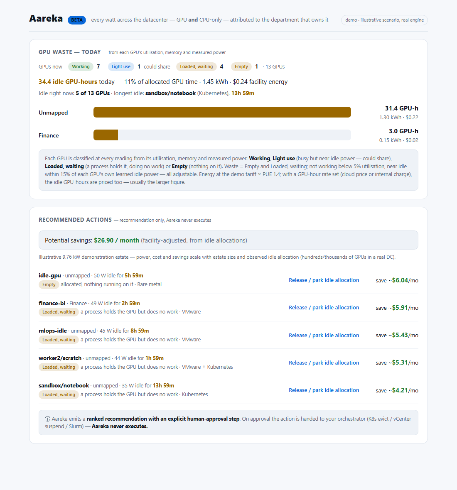

# Aareka

*A product of AICON Transformation Solutions*

Aareka is an open source tool for organisations that run their own datacenters. It
measures the power each server draws and shows which team uses every watt. For GPU
workloads it also finds the GPUs that sit idle, and for AI inference it measures the
energy each token costs.

It works from the power your servers actually draw, and it answers four questions:

- **How much energy does each token cost?** For every model you serve, Aareka reports
  joules per output token, tokens per joule and cost per million tokens, by model and by
  department. You can see which models, and which ways of serving them, use the most
  energy for the same output.
- **Which GPUs are wasted?** Aareka shows what each GPU is doing right now: working,
  lightly used, held by a job that does no work, or empty. It also shows how long each
  idle GPU has been idle, how many GPU hours that adds up to today, and what they cost.
- **Where does the power go?** Aareka attributes power, cost and carbon to the
  workloads, applications and departments that used them, across bare metal, VMware and
  Kubernetes. Every figure is labelled **measured** or **estimated**.
- **What should we do about it?** Aareka recommends actions, such as which idle GPUs to
  release and how much that would save each month. Your own team decides and acts.

Aareka works on mixed estates that cost tools built only for Kubernetes cannot read: bare
metal, VMware, hardware from different vendors, and servers with incomplete telemetry. It
counts the IT load first. Facility overhead and cooling (PUE) are added as a separate,
clearly labelled layer and are never mixed into the measured figures.

Aareka only reads. It never changes anything on your machines and never takes action for
you. It shows you what is happening and, where it finds a problem, what your team could do
about it.

---

## See it before you install

**[Open the live demo dashboard](https://aicontransformation.com/aareka-demo/)**

The demo shows the dashboard for an example datacenter, so you can see what Aareka
measures before you install anything. The datacenter is illustrative, but every figure on
the page was calculated by the real Aareka engine. The energy per token panel shows a real
measurement of Llama 3.2 3B, taken with the Aareka collector by sampling GPU power every
half second and dividing the energy by the tokens produced.

[](https://aicontransformation.com/aareka-demo/)

What you can see on the dashboard:

| Part of the dashboard | What it tells you |
|---|---|
| **Power, cost and carbon** | How much power your servers draw right now, and what that costs and emits per day at your electricity rate and carbon factor. Facility overhead (PUE) is shown separately. |
| **GPU waste today** | How many GPU hours were idle today, what share of all GPU time that is, and how many GPUs are idle right now. |
| **Energy per token** | How many joules each model uses per output token. In the demo's real measurement, the same model used seven times as much energy per token depending only on how its requests were served. |
| **Power by infrastructure and department** | How the power splits across bare metal, VMware and Kubernetes, and how much of it each department uses, with the idle part shown separately. |
| **GPU waste in detail** | The state of each GPU (Working, Light use, Loaded waiting or Empty), the idle GPU hours and their cost for each department, and how long each idle GPU has been idle. |
| **Recommended actions** | Which idle GPUs to release, and how much each would save per month. Aareka recommends; your team decides. |

[](https://aicontransformation.com/aareka-demo/)

---

## Quickstart

There are two ways to try Aareka. In both, you run the same collector: a small program
that reads your GPU machine and only makes outgoing connections.

### Option A: run everything yourself

You need Python 3.9 or newer, and an NVIDIA GPU with its driver installed (so that
`nvidia-smi` works) on the machine you want to measure. Everything below can run on that
one machine.

**1. Get the code and start the processor.** The processor receives the readings, works
out the figures and serves the dashboard.
```bash
git clone https://github.com/Aicon-Transformation-Solutions-LLP/Aareka_open_source.git
cd Aareka_open_source/Processor
pip install fastapi "uvicorn[standard]"
uvicorn ingest_api:app --host 127.0.0.1 --port 8080
```
When the processor starts, it prints a **collector key**. Copy it for step 3. The data is
kept in a local SQLite file called `aareka_ingest.db`.

All settings are optional. `AAREKA_DB_PATH` keeps the database somewhere else,
`AAREKA_COLLECTOR_KEY` lets you choose your own collector key, and `AAREKA_ACCOUNTS=1`
turns on accounts with logins, so that several organisations can share one processor. If
collectors on other machines need to send to it, start it with `--host 0.0.0.0` and put it
behind HTTPS, for example with a reverse proxy or load balancer.

**2. Open the dashboard.** Go to http://localhost:8080. There is no sign up or login: the
dashboard shows your data straight away and fills in as soon as a collector sends
readings. Anyone who can reach this address can see the dashboard, so keep the processor
on your internal network.

**3. Run the collector** in a second terminal:
```bash
cd Aareka_open_source/Collector
export AAREKA_INGEST_URL="http://localhost:8080"
export AAREKA_ORG_KEY="<the collector key the processor printed>"
python aareka_sender.py --once
```
You should see output like this (the numbers will differ):
```
  Aareka sender  ->  http://localhost:8080   source=local (gpu-node-01)
  gpu-node-01: HTTP 200  readings=2  attributed=1
      unmapped           61.3 W
```
Power shows as **unmapped** until you tell Aareka who owns what. See "Label who owns what"
below.

**4. Keep the collector running and refresh the dashboard.**
```bash
python aareka_sender.py            # sends every 60 s; press Ctrl+C to stop
```
GPU waste needs no setup. Each GPU's state appears with the first reading, and idle time
builds up from there. Each GPU learns its own idle power after five consecutive readings
at low use, which takes about five minutes at the default interval. You can change the
interval in seconds with `AAREKA_INTERVAL`.

On Windows PowerShell, set variables with `$env:AAREKA_ORG_KEY="..."` instead of `export`.

### Option B: use the hosted service

AICON Transformation Solutions also runs Aareka as a hosted service.

1. Go to **aareka.aicontransformation.com**, choose **Create your account**, and copy your
   collector key.
2. Run the collector exactly as in step 3 above, but set
   `AAREKA_INGEST_URL="https://aareka.aicontransformation.com"`.
3. Open the dashboard at the same address.

### Add energy per token

Point the collector at your inference server's Prometheus `/metrics` page. This works with
vLLM, SGLang, TGI, and llama.cpp started with `--metrics`. Between sends, the collector
measures GPU power every half second, adds it up into joules, and reads how many tokens
your server produced in the same period.
```bash
# vLLM on this machine, on GPU 0:
export AAREKA_METRICS_URL="http://127.0.0.1:8000/metrics|gpus=0"
# llama.cpp's counters do not include a model name, so give it one:
# export AAREKA_METRICS_URL="http://127.0.0.1:8080/metrics|model=llama3.2-3b|gpus=0"
# several servers: join entries with ";"   format: <url>[|model=<label>][|gpus=<i,j>]
```
The collector only reads your server's counters. It never runs or touches your models.
With token metering on, the first send waits one interval so that it has a full period to
measure. Machines that only train models can skip this step; power attribution and GPU
waste still work.

### Label who owns what (optional)

```bash
# maps a process name or VM name to a department
export AAREKA_DEPT_MAP='{"training-job":"Research","inference-svc":"Platform"}'
```
Anything without an owner is shown as **unmapped**. Aareka never guesses an owner.

**Trouble sending?** Run `python aareka_sender.py --once`; it prints the exact error. The
most common causes are a wrong or missing `AAREKA_ORG_KEY` (HTTP 401) or no network route
to the processor.

The full list of what the collector needs, for each mode, is in
[Overall_prerequisites.md](Overall_prerequisites.md).

---

## GPU waste

A GPU that is allocated but does no work still draws power and still costs its hourly
rate. At every reading, Aareka puts each GPU into one of these states:

| State | What it means | Counted as waste by default |
|---|---|---|
| **Empty** | No process is on the GPU, utilisation is below the threshold, and power is close to idle. | Yes |
| **Loaded, waiting** | A process holds the GPU, but utilisation is below the threshold. | Yes |
| **Light use** | Utilisation is above the threshold, but power is still close to idle. | No; shown as "could share" |
| **Working** | Utilisation is above the threshold and power is well above idle. | No |
| **Unknown** | The readings needed are not available. | Never |

**It works without any setup.** By default, a GPU below **5%** utilisation counts as not
working, power within **15%** of that GPU's own idle level counts as close to idle, and
**Empty** and **Loaded, waiting** count as waste. You can change any of these under
**Rates & waste thresholds** on the dashboard.

**Each GPU's idle power is learned, not assumed.** It is the lowest power the GPU held for
five consecutive readings while it was not working, over the last 30 days. Until a GPU has
done that, it is marked "learning" and is classified by its utilisation and ownership
alone. Estimated power is never used to learn it.

**Idle spells.** Consecutive readings in which the same GPU and owner are in a waste state
form a spell. Each spell records when it started, how long it lasted and how much energy
it used. Time with no readings is never counted as idle. Idle GPU hours and idle energy
are added up for each workload and each department, per day (in UTC). On a shared GPU
(vGPU or MIG), idle time is split by each owner's share and labelled **estimated**.

**Cost comes in two parts.** Once you set your rates on the dashboard, Aareka shows the
cost of waste as:

- idle GPU hours multiplied by your hourly rate for that GPU model, and
- idle energy multiplied by your electricity rate and PUE.

The two parts are always shown separately, each money figure shows the rate it used, and
all money is labelled "calculated from your rates". If you have not set a rate, Aareka
shows GPU hours and kWh only. It never makes up a price.

**Changing a threshold** asks you to confirm first, because past figures will change.
Aareka keeps every raw reading (utilisation, memory and power) and recalculates past
states, spells and totals with the new threshold.

**What it needs:** collector version 0.6.0 or newer in `local` mode, which sends each GPU's
utilisation, memory and model name. GPUs that report through an older collector are shown
as Unknown. The `vcenter`, `kubernetes` and `fleet` modes do not send readings for each
GPU yet, so their GPUs do not appear in GPU waste.

---

## Deployment modes: where to install, and what access it needs

The collector runs in one of four modes, which you choose with the `AAREKA_SOURCE`
environment variable. In every mode it only reads. It only makes outgoing connections to
the processor, never opens a port on your machines, and never writes to or sends commands
to your systems. The bare metal mode (`local`) is stable. The `vcenter`, `kubernetes` and
`fleet` modes are in **beta**: the code is complete and has been tested against sample
data, and it is checked against your real environment the first time it connects.

| `AAREKA_SOURCE` | Install it on | Access it needs | GPU waste | Status |
|---|---|---|---|---|
| `local` | each GPU server | local `nvidia-smi`; outgoing HTTPS | yes | stable |
| `vcenter` | one machine that can reach vCenter | a vCenter account that can only read; outgoing HTTPS | not yet | beta |
| `kubernetes` | one machine with a kubeconfig, or inside the cluster | read access to the Kubernetes API and Prometheus; outgoing HTTPS | not yet | beta |
| `fleet` | one control node | read access over SSH (or Prometheus or BMC) to the servers; outgoing HTTPS | not yet | beta |

### Bare metal (`local`)

Install the collector on **each GPU server** you want to measure. One server is enough for
a first test. The collector reads that machine directly, so it needs:

- the **NVIDIA driver**, so that `nvidia-smi` works. This gives measured GPU power, GPU
  utilisation and memory, and which process is using each GPU;
- optionally, permission to read the CPU energy counter (root on Linux), for measured CPU
  power;
- optionally, read access to the server's management controller (BMC, iDRAC or iLO,
  through Redfish or IPMI), for an exact total for the whole machine;
- **outgoing HTTPS (port 443)** to the processor. Nothing needs to be opened for incoming
  connections.

### VMware and vCenter (`vcenter`)

Install the collector on **one machine that can reach your vCenter over the network**. You
do **not** install anything on the ESXi hosts or inside the virtual machines. One
connection to vCenter returns each host's total power, each virtual machine's CPU and
memory allocation, its GPU assignment (passthrough or vGPU), and its department tag. It
needs a **vCenter account that can only read**, network access to the **vCenter API (TCP
443)**, and **outgoing HTTPS** to the processor.

### Kubernetes (`kubernetes`)

Install the collector on **one machine that holds a kubeconfig with read access**, or run
it inside the cluster as a pod with a service account that can only read. Kubernetes tells
Aareka which pod runs on which node, with its CPU request, memory, GPU count and labels.
The power figures come from your monitoring system. It needs **read access to the
Kubernetes API**, a **Prometheus** server that collects `dcgm-exporter` (GPU power) and
`node-exporter` (CPU power), and **outgoing HTTPS** to the processor.

### Fleet: many bare metal servers from one place (`fleet`)

If you have many bare metal servers and would rather not install the collector on each
one, run it on **one control node** that can already reach them. It reads each server's
total power and labels each server with the business unit that owns it, using the list
your IT team provides (see below). The processor then attributes the power. It needs
**read access over SSH** to each server (or to their Prometheus or BMC endpoints) and
**outgoing HTTPS** to the processor.

---

## What we need from your IT team: who owns what

Aareka answers two questions, and it needs your help with the second one:

1. **How much power did each workload draw?** Aareka measures this automatically, in every
   mode.
2. **Which team, application or business unit owns that power?** This is a fact about your
   organisation that telemetry cannot reveal, so it has to come from you.

Where this information comes from depends on your estate:

- **VMware:** ideally, each VM already records its department in a vCenter **custom
  attribute or tag**, which Aareka reads directly. If not, provide a list that maps each VM
  name to a business unit.
- **Kubernetes:** the owning team is usually already a **label** (for example `app` or
  `team`) or the **namespace**, and Aareka reads both. You can override this with your own
  list.
- **Bare metal and fleet:** there is nothing to read the owner from, so your IT team
  provides a simple list that maps each server to an application or business unit (for
  example, `gpu-node-01 → Research`).

**If you do not have this list yet,** Aareka never guesses and never stops working. It
still measures power and attributes it to each workload, VM, pod or server, and the totals
still add up. The only thing missing is the roll up to business units: anything without an
owner appears as **unmapped** instead of being charged to the wrong team. You can start
measuring straight away and add owners as you go.

---

## Repository layout

| Folder | What it holds |
|---|---|
| [`Collector/`](Collector) | The collector that runs on your machines. It reads power, GPU utilisation and memory, ownership and token counts. Start with `aareka_sender.py`. |
| [`Processor/`](Processor) | The processor and the dashboard. It receives readings, attributes power, and works out energy per token and GPU waste. It runs on any machine with Python. Start with `ingest_api.py`. |

Documentation:

- [Overall_prerequisites.md](Overall_prerequisites.md) explains what the collector needs in
  each mode. The same guide is in `Collector_Prerequisites.docx`.
- `Collector_Code_Glossary.docx` and `Processor_Code_Glossary.docx` describe each code file
  in a few sentences.

---

## The problem

You run servers in datacenters you own, and more of them now carry GPUs for AI,
research or rendering. Your power use has grown, and nobody can say which team,
application or pipeline is responsible. The facility team sees a spike in power, the
application teams see their jobs, and nobody can connect the two. Meanwhile, some of the
servers and GPUs you pay for sit allocated but idle, and nobody notices.

- **Facility tools** (DCIM and energy platforms) measure real power, but only for a rack or
  a building. They do not know which software was running.
- **Cost tools** (OpenCost, Kubecost and Cast AI) assign costs to workloads, but they do it
  by multiplying the hours a resource was used by a price, or by reading GPU telemetry
  inside Kubernetes. They do not account for the energy of whole servers across an estate
  that mixes bare metal, VMware and Kubernetes.

Aareka fills the gap between them. It combines the power readings from all kinds of
hardware into one account of the energy each whole server used, gives every figure a
confidence score, and assigns the energy to the teams that own it, across private and
hybrid estates.

---

## Why you can trust the numbers

Every GPU already reports its own power, and so do the usual monitoring tools. Aareka
focuses on what those tools leave out:

- **Measured and estimated figures are always labelled.** Every reading is marked
  `measured` (from a physical sensor) or `modeled` (estimated), with a margin of error. An
  estimate is never presented as a measurement. Where physical meters exist, Aareka reports
  metered energy; where they do not, it gives a clearly bounded estimate.
- **Totals add up.** Where a meter for the whole machine exists, Aareka checks the
  component readings against it, so nothing is counted twice. A rack meter is never
  mistaken for a single server.
- **It is honest about what it cannot see.** Without a meter for the whole machine, Aareka
  reports a range for the parts it cannot measure (fans, storage and power supply losses):
  a measured minimum plus a stated estimate, not a falsely precise number. A GPU sensor
  measures the GPU, not the whole server, and Aareka says so. A missing reading is shown
  as not available, never as zero.
- **Every value shows where it came from.** Aareka reads whatever telemetry each server
  offers, trying the most detailed source first. For every value it records the source and
  method: a hardware meter for the whole machine (BMC, Redfish or IPMI), GPU telemetry
  (DCGM or NVML), the processor's energy counter (RAPL), or a model. If a source is
  missing, it falls back to the next one and reports how complete and reliable the result
  is. It polls lightly and infrequently, so it does not overload management controllers or
  the management network.
- **Rack meters stay at rack level.** Readings from a rack's power distribution unit are
  kept for checking rack totals. They are never treated as one server's measurement unless
  there is a valid way to divide them.
- **Results are ready for review.** Power rolls up from workloads to applications,
  services and business units, with a confidence score weighted by energy and a record of
  where each reading came from. This is suitable for internal showback, capacity planning
  and audits.

On a partitioned GPU (MIG or vGPU), Aareka divides power by each partition's allocation by
default. This is a stated policy for dividing the power, not a claim that each partition
physically draws that share. Validating the actual share drawn by each workload is on the
roadmap.

---

## How Aareka differs from GPU utilisation tools

If you already use NVIDIA Run:ai, Cast AI, Kubecost, ScaleOps, or DCGM Exporter with
Prometheus and Grafana, you already see **GPU power and utilisation on Kubernetes**.
Aareka differs in three ways:

- **It measures whole servers, not just GPUs.** Those tools read the power and utilisation
  of the GPU itself. Aareka accounts for the whole server: the GPU, the CPU, the memory,
  and the parts it cannot measure directly (fans, storage and power supply losses),
  checked against a physical meter where one exists. In a real datacenter, the power used
  outside the GPU is significant.
- **It gives numbers you can defend.** A metric is just a number; Aareka's figures can
  stand up to scrutiny. It labels every figure as measured or estimated, checks it against
  a total, and shows what it could not attribute, instead of presenting a GPU reading as
  the whole answer.
- **It covers your whole estate, not just Kubernetes.** Cost tools built for Kubernetes
  depend on information that Kubernetes provides. Aareka keeps attributing power where
  that information is incomplete or missing, across bare metal, VMware and mixed estates,
  which is where most enterprises still run much of their work, including new AI
  workloads.

Utilisation tools answer the question "is this GPU busy, and how much power does it
draw?" Aareka answers "how was this energy assigned to this workload, under what rule, and
can I defend that figure to finance?"

---

## Measure first, then act

Reporting alone does not save anything. Aareka points out where action would pay off:
idle and waiting GPUs and what they cost, power it could not attribute, workloads with
unusually high energy use, and the risk of running out of power capacity. All of these are
based on measured energy, not on GPU utilisation alone. Detailed scheduling advice, such as
which workload to stop and when, needs information about ownership, priority and service
levels, so Aareka does not claim to offer it today.

Aareka stops at a **recommendation**. Releasing an idle GPU or stopping a workload is a
decision for your team, carried out with your own scheduler (Kubernetes, Slurm or
vSphere). **Aareka never acts on your systems.** This is deliberate: because it has no way
to write to your systems, there is nothing in it for an attacker to misuse.

You can run Aareka yourself, including in restricted or isolated environments where
telemetry must not leave the site, or you can use the hosted service.

```
[ Physical power and telemetry ]
            |
[ Checked and labelled ]                  (measured or estimated)
            |
[ Assigned to workloads ]                 (application, service, business unit)
            |
[ Energy per token and GPU waste ]        (what the power produced, what sat idle)
            |
[ Problems found and actions ranked ]
            |
[ Your team approves ]  ->  [ Your scheduler acts ]
```

---

## Who Aareka is for

Aareka is for any organisation that runs its own servers and wants to know which team
uses the power, what it costs and what it emits. Power attribution, cost and carbon work
for any server Aareka can read. Two features depend on the workload: GPU waste needs
NVIDIA GPUs, and energy per token needs a language model inference server.

| Type of estate | What Aareka gives you |
|---|---|
| **AI training and inference** | Everything: power by team, GPU waste, and energy per token for every model you serve. |
| **HPC and research clusters** | Power by team and GPU waste on shared GPU clusters, which are often bare metal and scheduled with Slurm. Power is attributed by process, by server, or from a list of which server belongs to which group; attribution to individual Slurm jobs is not built yet. |
| **Rendering, visual effects, simulation and video transcoding** | Power by team and GPU waste, which matters wherever GPUs sit allocated between jobs. |
| **Private clouds on VMware** | Each host's measured power split across its virtual machines and departments, for chargeback, showback and carbon reporting. This works for servers without GPUs too. (Beta) |
| **Kubernetes platforms** | Each node's measured power split across its pods and namespaces, for any kind of workload. (Beta) |
| **Enterprise servers on bare metal** | Power, cost and carbon for databases, business applications and other services. CPU power is measured on Linux; on Windows it is estimated. A management controller (BMC or IPMI) gives an exact total for each machine. |

**Where Aareka fits less well:**

- **Colocation providers** can measure each customer's racks, but they usually cannot run
  software inside their customers' servers, so Aareka cannot attribute power to workloads
  there.
- **Public cloud users** cannot read the physical power of the hardware they rent. Their
  spending is already itemised, although nobody accounts for its energy or emissions by
  team.
- **AMD and Intel GPUs** are not yet read directly. Power can still be attributed from a
  meter for the whole machine, but GPU waste and the power of each GPU currently rely on
  NVIDIA's tools.

---

## What comes next

**GPU waste in every mode.** Today, GPU waste works in `local` mode. Next, the same GPU
readings will come from DCGM in Kubernetes and from vCenter in VMware estates.

**Storage and network as separate parts.** Today, the power used by storage and network
cards is included in each server's total but not shown separately. A future version will
show them as their own components. They will be measured where the hardware reports them
(Redfish component readings and NVIDIA DPU telemetry; a BlueField DPU alone can draw about
75 W) and estimated from each drive's and card's rated power otherwise. They will then be
attributed to the workload that uses them, so a team's full footprint (compute, memory,
storage and network) rolls up to its department.

Reliable measurement of IT power is the foundation for further work, such as allocating
facility overhead, reporting emissions, and deciding where to place workloads based on
cost, energy and power limits. Aareka does not do these things today, and they are not
planned for the near term. They are mentioned only to show where reliable measurement
leads. Measurement is the product now.

---

## Status

Aareka is a prototype. Power attribution and energy per token have been measured on real
hardware: an NVIDIA RTX 3050 running Llama 3.2 3B. GPU waste monitoring has been checked
against real readings from that machine, and against simulated readings for the states that
machine could not produce; it has not yet run on a production cluster. The integrations
for live clusters and management controllers are written against the standard interfaces
(Redfish, DCGM, vSphere and Kubernetes) and tested against simulated systems; they have not
yet run in a production environment. **We are looking for a design partner for the first
live deployment.** Treat Aareka as a working foundation, not a finished product.

---

## Open source

Everything in this repository, including the collector, the processor and the dashboard,
is open source under the Apache 2.0 licence. You can run it yourself, change it and build
on it. AICON Transformation Solutions also offers Aareka as a hosted service, and support
for teams that run it themselves.

See [LICENSE](LICENSE).

---

## About the name

*Aareka* combines आरेख (*aarekh*, "the chart" or "the diagram") with *eureka*: the moment
you finally see where your power goes. Aareka is a project of AICON Transformation
Solutions.

## Not affiliated

Aareka is not affiliated with NVIDIA or with any datacenter or energy vendor. DCGM,
Redfish, Kubernetes and vSphere are trademarks of their respective owners and are
mentioned only to describe compatibility.
