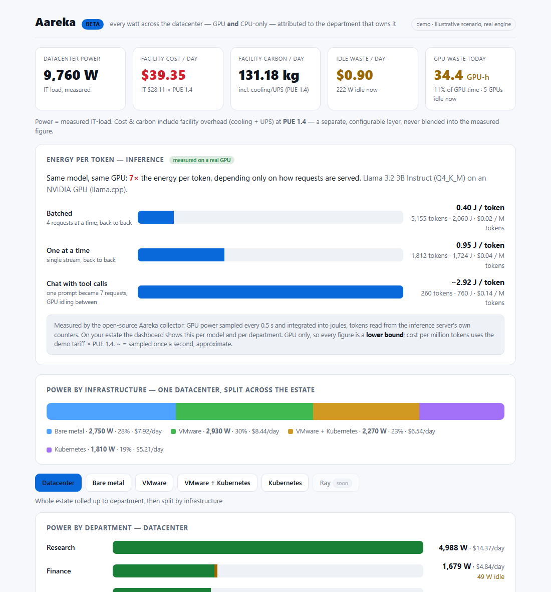

# Aareka - A Product of AICON Transformation Solutions

**Watts per token, GPU waste, and every watt traced to the team that used it — for the AI
datacenters you run yourself.**

Aareka measures the power your GPU servers actually draw and turns it into the answers
that drive your AI power bill:

- **Watts per token.** For every model you serve: joules per output token, tokens per
  joule, and cost per million tokens, per model and per department. See which models,
  and which ways of serving them, burn the most energy for the same output.
- **GPU waste.** What each GPU is doing right now (working, lightly used, held by a job
  that does nothing, or empty), how long it has sat idle, how many GPU-hours that adds
  up to today, and what it costs.
- **Where every watt goes.** Power, cost and carbon, attributed to the workloads,
  applications and departments responsible, across bare metal, VMware and Kubernetes,
  with each figure labelled **measured or estimated**.
- **What to do about it.** Ranked recommendations, such as which idle GPUs to release
  and what that saves per month. Aareka recommends; your own team acts.

It runs on the mixed estates that Kubernetes-only cost tools can't read: bare metal,
VMware, hardware from different vendors, and servers with incomplete telemetry. IT load
is counted first; facility overhead and cooling (PUE) are applied as a separate, labelled
layer and never folded into the measured figures.

Aareka is **read-only**. It never touches production. It shows you what is actually
happening and, where it finds a problem, what your own team could do about it. It never
takes that action for you.

---

## See it before you install

**[Open the live demo dashboard →](https://aicontransformation.com/aareka-demo/)**

The demo shows the dashboard for an example datacenter, so you can see what Aareka
measures before installing anything. The estate is illustrative; every figure on it was
computed by the real Aareka engine, and the energy-per-token figures are a real
measurement on an NVIDIA RTX 3050.

[](https://aicontransformation.com/aareka-demo/)

What you can see on it:

| Part of the dashboard | What it tells you |
|---|---|
| **Power, cost and carbon** | Measured IT load right now, and what it costs and emits per day at your electricity rate and carbon factor, with facility overhead (PUE) shown as a separate layer. |
| **GPU waste today** | Idle GPU-hours today, their share of all GPU time, and how many GPUs are idle right now. |
| **Energy per token** | Joules per output token for each model you serve. The demo's real measurement shows the same model using 7× the energy per token depending only on how requests are served. |
| **Power by infrastructure and department** | Every watt split across bare metal, VMware and Kubernetes, then rolled up to the department that owns it, with the idle part of each shown separately. |
| **GPU waste in detail** | Each GPU's state (Working, Light use, Loaded waiting, Empty), idle GPU-hours and their cost by department, and how long each idle GPU has been idle. |
| **Recommended actions** | Which idle GPUs to release and what that would save per month. Aareka recommends; your own team acts. |

[](https://aicontransformation.com/aareka-demo/)

---

## Quickstart

Two ways to try it. Either way the collector is the same: a read-only program that runs on
your GPU machine and makes outbound calls only.

### Option A: run everything yourself

You need Python 3.9 or newer, and an NVIDIA GPU with its driver installed (so that
`nvidia-smi` works) on the machine you want to measure. Everything below can run on that
one machine.

**1. Get the code and start the processor.** The processor receives readings, attributes them and
serves the dashboard.
```bash
git clone https://github.com/Aicon-Transformation-Solutions-LLP/Aareka_open_source.git
cd Aareka_open_source/Processor
pip install fastapi "uvicorn[standard]"
uvicorn ingest_api:app --host 127.0.0.1 --port 8080
```
When it starts it prints a **collector key**; copy it for step 3. Data is kept in a local
SQLite file, `aareka_ingest.db`. Every setting is optional: `AAREKA_DB_PATH` keeps the
database somewhere else, `AAREKA_COLLECTOR_KEY` chooses your own collector key, and
`AAREKA_ACCOUNTS=1` turns on sign-up and login for several organisations sharing one
processor. To let collectors on other machines send to it, start it with `--host 0.0.0.0`
and put it behind HTTPS (a reverse proxy or load balancer).

**2. Open the dashboard.** Open http://localhost:8080. There is no sign-up or login: it
shows this site's data straight away, and fills in as soon as a collector sends. Anyone who
can reach this address can see it, so keep the processor on your internal network.

**3. Run the collector**, in a second terminal:
```bash
cd Aareka_open_source/Collector
export AAREKA_INGEST_URL="http://localhost:8080"
export AAREKA_ORG_KEY="<the collector key the processor printed>"
python aareka_sender.py --once
```
Expected output (numbers illustrative):
```
  Aareka sender  ->  http://localhost:8080   source=local (gpu-node-01)
  gpu-node-01: HTTP 200  readings=2  attributed=1
      unmapped           61.3 W
```
Power shows as **unmapped** until you say who owns what (see "Label who owns what" below).

**4. Keep it running and open the dashboard.**
```bash
python aareka_sender.py            # sends every 60 s; Ctrl+C to stop
```
Refresh http://localhost:8080. GPU waste needs no setup: each GPU's state appears with
the first reading, and idle time builds up from there. Each GPU learns its own idle power
after five back-to-back low-use readings, about five minutes at the default interval
(`AAREKA_INTERVAL` sets the interval in seconds).

On Windows PowerShell, set variables with `$env:AAREKA_ORG_KEY="..."` instead of `export`.

### Option B: use the hosted service

AICON Transformation Solutions runs Aareka as a hosted service.

1. Go to **aareka.aicontransformation.com**, choose **Create your account**, and copy
   your collector key.
2. Run the collector exactly as in step 3 above, with
   `AAREKA_INGEST_URL="https://aareka.aicontransformation.com"`.
3. Refresh the dashboard at the same address.

### Add energy per token

Point the collector at your inference server's Prometheus `/metrics` page (vLLM, SGLang,
TGI, or llama.cpp started with `--metrics`). Between sends it integrates GPU power every
0.5 s into joules and reads the tokens your server produced in the same window.
```bash
# vLLM on this machine, on GPU 0:
export AAREKA_METRICS_URL="http://127.0.0.1:8000/metrics|gpus=0"
# llama.cpp's counters carry no model name, so label it:
# export AAREKA_METRICS_URL="http://127.0.0.1:8080/metrics|model=llama3.2-3b|gpus=0"
# several servers: join entries with ";"   format: <url>[|model=<label>][|gpus=<i,j>]
```
The collector only reads your server's counters; it never runs or touches your models.
With token metering on, the first send waits one interval so it has a measured window.
Training-only machines can skip this; power attribution and GPU waste still work.

### Label who owns what (optional)

```bash
# maps a process name or VM name to a department
export AAREKA_DEPT_MAP='{"training-job":"Research","inference-svc":"Platform"}'
```
Anything without an owner is shown as **unmapped**, never guessed.

**Trouble sending?** `python aareka_sender.py --once` prints the exact HTTP error. The most
common causes are a wrong or missing `AAREKA_ORG_KEY` (HTTP 401) or no network route to
the processor.

Full collector requirements, per mode: [Overall_prerequisites.md](Overall_prerequisites.md).

---

## GPU waste

An allocated GPU that does no work still draws power and still costs its GPU-hour rate.
At every reading Aareka puts each GPU into one state:

| State | What it means | Counted as waste by default |
|---|---|---|
| **Empty** | No process on the GPU, utilisation below the threshold, power close to idle | Yes |
| **Loaded, waiting** | A process holds the GPU, but utilisation is below the threshold | Yes |
| **Light use** | Utilisation above the threshold, but power still close to idle | No; shown as "could share" |
| **Working** | Utilisation above the threshold and power well above idle | No |
| **Unknown** | The readings needed are not available | Never |

**It works out of the box.** The defaults are: below **5%** utilisation a GPU counts as not
working, power within **15%** of that GPU's own idle level counts as close to idle, and
**Empty** and **Loaded, waiting** count as waste. You can change any of them under
**Rates & waste thresholds** on the dashboard.

**Idle power is learned per GPU, not assumed.** It is the lowest power a GPU held for five
back-to-back readings while not working, over the last 30 days. Until a GPU has shown
that, it is marked "learning" and is classified on utilisation and ownership alone.
Modeled (estimated) power is never used to learn it.

**Idle spells.** Back-to-back readings in a waste state for the same GPU and owner form a
spell, with a start time, a duration and the energy drawn. Time with no readings is never
counted as idle. Idle GPU-hours and idle energy are totalled per workload and per
department per day (UTC days). On a shared GPU (vGPU or MIG), idle time is split by each
owner's share and labelled **estimated**.

**Cost, in two parts.** With your rates set on the dashboard, waste cost is shown as:

- idle GPU-hours × your GPU-hour rate for that GPU model, and
- idle energy × your electricity rate × PUE.

The two parts are always shown separately, with the rate used beside every money figure,
and labelled "calculated from your rates". A rate you have not set gives no money figure:
you see GPU-hours and kWh only, never a made-up price.

**Changing a threshold** asks you to confirm first, because past figures change: Aareka
keeps every raw reading (utilisation, memory and power), and recalculates past states,
spells and totals from them with the new threshold.

**What it needs:** collector 0.6.0 or newer in `local` mode, which sends each GPU's
utilisation, memory and model name. GPUs from an older collector are shown as Unknown.
`vcenter`, `kubernetes` and `fleet` modes don't send per-GPU readings yet, so their GPUs
don't appear in GPU waste.

---

## Deployment modes: where to install, and what access it needs

The collector runs in one of four modes, selected with the `AAREKA_SOURCE` environment
variable. In every mode it is **read-only**: it makes **outbound calls only** to the processor,
never opens an inbound port on your machines, and never writes to or issues commands
against your systems. Bare metal (`local`) is stable; the `vcenter`, `kubernetes` and
`fleet` modes are **beta**: the code is complete and tested against fixtures, and is
validated against your real environment on first connect.

| `AAREKA_SOURCE` | Install it on | Access it needs | GPU waste | Status |
|---|---|---|---|---|
| `local` | each GPU server | local `nvidia-smi`; outbound HTTPS | yes | stable |
| `vcenter` | one machine that can reach vCenter | read-only vCenter account; outbound HTTPS | not yet | beta |
| `kubernetes` | one machine with a kubeconfig, or in-cluster | read-only Kubernetes API + Prometheus; outbound HTTPS | not yet | beta |
| `fleet` | one control node | read-only SSH (or Prometheus/BMC) to the servers; outbound HTTPS | not yet | beta |

### Bare metal (`local`)

Install the collector on **each GPU server** you want to measure; a single server is enough
for a first test. It reads that machine directly, so it needs:

- the **NVIDIA driver**, so that `nvidia-smi` works. This provides measured GPU power, GPU
  utilisation and memory, and which process is using each GPU;
- optionally, permission to read the CPU energy counter (root on Linux) for measured CPU
  power;
- optionally, **read-only** access to the server's management controller (BMC / iDRAC /
  iLO, via Redfish or IPMI) for an exact whole-machine total;
- **outbound HTTPS (port 443)** to the processor. Nothing needs to be opened inbound.

### VMware / vCenter (`vcenter`)

Install the collector on **one machine that can reach your vCenter over the network**. You
do **not** install anything on the ESXi hosts or inside the virtual machines. A single
read-only connection to vCenter returns each host's total power, every virtual machine's
vCPU and memory allocation, its GPU assignment (passthrough or vGPU), and its department
tag. It needs a **read-only vCenter account**, network access to the **vCenter API (TCP
443)**, and **outbound HTTPS** to the processor.

### Kubernetes (`kubernetes`)

Install the collector on **one machine that holds a read-only kubeconfig**, or run it
inside the cluster as a pod with a read-only service account. Kubernetes supplies the
topology (which pod runs on which node, with its CPU request, memory, GPU count and
labels), and the power figures come from your monitoring stack. It needs **read-only
access to the Kubernetes API**, a **Prometheus** endpoint that scrapes `dcgm-exporter` (GPU
power) and `node-exporter` (CPU power), and **outbound HTTPS** to the processor.

### Fleet: many bare-metal servers from one place (`fleet`)

When you have many bare-metal servers and would rather not install an agent on each one,
run the collector on **one control node** that can already reach them. It sweeps every
server for its total power and labels each whole server with its owning business unit,
using the mapping your IT team provides (see below); the processor then attributes the
power. It needs **read-only SSH** to each
server (or their Prometheus / BMC endpoints) and **outbound HTTPS** to the processor.

---

## What we need from your IT team: the ownership mapping

Aareka answers two questions, and it can only answer the second one with your help:

1. **How much power did each workload draw?** Measured automatically, in every mode.
2. **Which team, application or business unit owns that power?** This is an *ownership
   fact*, not something that can be inferred from telemetry, so it has to come from you.

Where the mapping comes from depends on the estate:

- **VMware:** ideally the department is already recorded on each VM as a vCenter **custom
  attribute or tag**, which Aareka reads directly. If not, supply a VM-name → business-unit
  mapping.
- **Kubernetes:** the owning team is usually already a **label** (for example `app` or
  `team`) or the **namespace**, both of which Aareka reads. An explicit mapping can override
  this.
- **Bare metal / fleet:** there is no orchestrator to read, so your IT team provides a
  simple **server → application/business-unit** list (for example,
  `gpu-node-01 → Research`).

**If the mapping isn't available,** Aareka never guesses and never blocks. Power is still
measured and attributed down to each workload, VM, pod or server, and the totals still
reconcile. What you lose is the business roll-up: anything without an owner appears in an
honest **unmapped** bucket rather than being charged to the wrong team. You can start
measuring straight away and fill in the mapping as you go.

---

## Repository layout

| Folder | What it holds |
|---|---|
| [`Collector/`](Collector) | The read-only collector that runs on your machines: power readings, GPU utilisation and memory, ownership, token metering. Start with `aareka_sender.py`. |
| [`Processor/`](Processor) | The processor and dashboard: the ingest API, attribution, energy per token, GPU waste, and the dashboard with its rates and thresholds. It runs on any machine with Python. Start with `ingest_api.py`. |

Documentation:

- [Overall_prerequisites.md](Overall_prerequisites.md): what the collector needs, per
  mode (also as `Collector_Prerequisites.docx`).
- `Collector_Code_Glossary.docx` and `Processor_Code_Glossary.docx`: one short
  description per code file.

---

## The problem

You started running AI in datacenters you own. Your power draw jumped, unpredictably,
and no one can defend which team, application, or pipeline is driving it. The facility
team sees a power spike; the AI teams see their jobs; nobody can connect the two. And
some of the GPUs you are paying for sit allocated but idle, with nobody noticing.

- **Facility tools** (DCIM, energy platforms) measure real power — but stop at the
  rack or the building. They don't know what software ran.
- **Cost tools** (OpenCost, Kubecost, Cast AI) attribute to workloads — but by
  multiplying resource-hours by a configured price, or by reading device-level
  telemetry inside Kubernetes. They don't reconcile whole-server energy across a
  mixed, non-Kubernetes estate.

Aareka is the layer between them: it reconciles heterogeneous physical telemetry into
a confidence-scored, whole-server energy ledger, attributed to business ownership,
across private and hybrid estates — including bare metal and virtualized
infrastructure.

---

## What makes the number trustworthy

Not "we show GPU watts" — every GPU already reports that, and so do the utilization
tools. Aareka is built around the accounting gap those tools leave:

- **Measured vs estimated, visibly labeled.** Every reading is tagged `measured`
  (from a physical sensor) or `modeled` (estimated), with an error band. No modeled
  number is ever presented as measured. Aareka produces metered energy figures where
  physical meters exist, and clearly bounded estimates where they do not.
- **Reconciled to server totals.** Component readings are reconciled against a
  whole-box meter where one exists, so nothing is double-counted; a rack meter is
  never mistaken for a server.
- **Honest about what it can't see.** With no whole-box meter, Aareka reports a
  bounded range for the unmeasured tail (fans, storage, PSU loss) — a floor plus a
  stated estimate, not false precision. A device-level GPU sensor is a device reading,
  not the whole server's electrical draw; Aareka is explicit about the difference.
  A reading that is missing is shown as not available, never as zero.
- **Provenance by source and method.** A fallback ladder reads whichever telemetry
  each server exposes and records, for every value, its scope, source, and measurement
  method — hardware meter (BMC/Redfish/IPMI whole-box), device telemetry (DCGM/NVML
  GPU), processor counter (RAPL, an energy counter, not a meter), or model. It
  degrades gracefully, reporting coverage and confidence. Polling is lightweight and
  low-frequency, so it does not saturate BMC interfaces or the management network.
- **Rack meters stay at rack scope.** Rack-PDU readings are retained for rack-level
  reconciliation and coverage; they are never treated as an individual server
  measurement unless a valid allocation mechanism is present.
- **Audit-ready provenance.** Attribution rolls up to app, service, and business unit
  with energy-weighted confidence and per-reading source lineage, suitable for
  internal showback, capacity planning, and review.

Where partitioning (MIG, vGPU) is used, allocation follows partition entitlement as
the default policy; this is a disclosed allocation basis, not a claim that partitions draw
proportional physical power. Workload-level marginal validation is a roadmap item.

---

## How this differs from GPU utilization tools

If you already run NVIDIA Run:ai, Cast AI, Kubecost, ScaleOps, or a DCGM-Exporter →
Prometheus → Grafana stack, you have **GPU power and utilization on Kubernetes**.
Aareka differs on scope and accounting integrity, on three lines:

- **Whole-server energy, not device telemetry.** Those tools read GPU device power and
  utilization. Aareka reconciles the *whole server* — GPU **and** CPU, memory, and the
  unmeasured tail (fans, storage, PSU loss) — against a physical meter where one
  exists. In a real datacenter the non-GPU load is not a rounding error.
- **Accounting integrity, not raw metrics.** A metric is a number; a ledger is a
  number you can defend. Aareka labels every figure measured-or-modeled, reconciles it
  to a total, and surfaces what it could not attribute — rather than presenting a
  device reading as if it were the answer.
- **Your estate, not just pods.** Kubernetes-focused cost and allocation tools depend
  on orchestration metadata. Aareka is designed to preserve attribution where that
  metadata is incomplete or absent — across bare metal, virtualized, and mixed
  estates, where most enterprises actually run their newly-arrived AI.

Utilization tools answer "is this GPU busy, and what does it draw?" Aareka answers
"how was this measured energy attributed to this workload, under what policy, and can I
defend that number to finance?"

---

## Truth first, action second

A ledger that only reports is inert. Aareka points to where action would pay off:
idle and waiting GPUs with what they cost, attribution gaps, abnormally high energy
intensity, and power-capacity risk — all shaped by measured energy, not
GPU-utilization heuristics alone. Deeper scheduling recommendations (which workload to
shed, when) require ownership, priority, and SLA context and follow validated customer
data; they are not claimed for the measurement product today.

But it stops at a **recommendation**. Releasing an idle GPU or shedding a workload is
for your own team, through your existing orchestrator (Kubernetes, Slurm, vSphere).
**Aareka never executes.** That boundary is deliberate: no write path, nothing to
compromise.

You can run Aareka yourself, including in restricted or air-gapped environments where
telemetry must not leave the site, or use the hosted service.

```
[ Physical power & telemetry ]
            |
[ Reconciliation & confidence tagging ]   (measured vs modeled)
            |
[ Workload attribution ]                  (app / service / business unit)
            |
[ Energy per token · GPU waste ]          (what the power bought, what sat idle)
            |
[ Constraint detection & ranked action ]
            |
[ Human approval ]  ->  [ Your orchestrator executes ]
```

---

## Where it fits

**Initial focus: enterprise private and hybrid GPU estates with VMware/bare-metal
legacy infrastructure and multiple internal AI teams.** The pain is concrete: you
bought expensive GPU capacity, the facility team sees a power spike, and nobody can
defend which team owns it — or say how much of that capacity sat idle.

HPC and research clusters fit the same profile — often bare metal, Slurm-scheduled,
with non-standard telemetry where Kubernetes-native cost tools do not operate at
all.

Aareka is optimized for owned and hybrid estates, where cloud-style billing data is
absent and physical power constraints matter most. It is less relevant to pure
public-cloud consumers whose *spend* is already itemized — though energy attribution,
capacity, and emissions accountability remain unmet even there.

---

## Where this is heading

**GPU waste in every mode.** Today GPU waste works in `local` mode. Next, the same
per-GPU readings come from DCGM in Kubernetes and from vCenter in VMware estates.

**Component-level breakout — storage and NIC/DPU.** Today storage and network draw are
reconciled *within* the whole-server total but not itemized. A next version breaks them
out as first-class components — measured where the hardware exposes it (Redfish
per-component, NVIDIA DPU telemetry; a BlueField DPU alone can draw ~75 W), modeled
per-device otherwise (per-drive, per-NIC TDP) — and attributes them to the owning
workload, so a team's *full* footprint (compute + memory + storage + network) rolls up
to its department.

A trustworthy IT-load energy ledger is the foundation other layers can eventually sit
on — facility-overhead allocation, emissions-factor reporting, and workload placement
decisions across cost, energy, and power constraints. These are explicitly not
near-term claims and Aareka does not do them today; they are noted only to show where a
defensible measurement layer leads. Measurement is the product now.

---

## Status

Prototype. Power attribution and energy per token have been measured on real hardware
(an NVIDIA RTX 3050 running Llama 3.2 3B). GPU waste monitoring has been checked against
real readings from that machine, and against simulated readings for the states it could
not reach; it has not yet run on a production cluster. The live-cluster and live-BMC
integrations are written against the standard interfaces (Redfish, DCGM, vSphere,
Kubernetes) and exercised against mocks; they have not yet run end-to-end in a
production environment. **We are seeking a design partner for the first live
deployment.** Treat this as a working foundation, not a finished product.

---

## Open source

Everything in this repository — the collector, the processor and the dashboard — is open
source under the Apache 2.0 licence. You can run it yourself, change it and build on it.
AICON Transformation Solutions also offers Aareka as a hosted service, and support for
teams running it themselves.

See [LICENSE](LICENSE).

---

## About the name

*Aareka* — from आरेख (*aarekh*, "the chart" / "the diagram") + *eureka*: the moment you
finally see where your power goes. A project of AICON Transformation Solutions.

## Not affiliated with

NVIDIA, or any datacenter or energy vendor. "DCGM", "Redfish", "Kubernetes",
"vSphere" are trademarks of their respective owners, referenced only for
interoperability.
